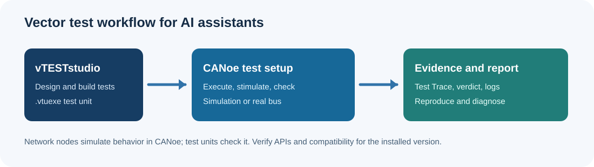

# VECTOR Skills

**Community AI skills for Vector CANoe and vTESTstudio**  
Maintainer: **Patiphan Phakdeeburi (TOPTUBBY)** · Skill version: **0.2.0** · [MIT license](LICENSE)

> คู่มือช่วยให้ AI แยกบทบาท CANoe กับ vTESTstudio, อ้างอิงเอกสารตามเวอร์ชัน, และตรวจ compatibility ก่อนแนะนำขั้นตอนหรือเขียน CAPL/test unit เอกสารต้นฉบับของ Vector อยู่ในเครื่องผู้ใช้และไม่ได้อัปโหลดลงรีโปสาธารณะ



## What it covers

| Product | Studied source | Tasks covered |
| --- | --- | --- |
| CANoe 14 SP2 | Local `Help01` HTML/CHM and `Doc` references | Simulation vs test setup, network nodes, CAPL navigation, diagnostics, logs, COM/.NET, Test Trace |
| vTESTstudio 3.0 SP3 | Local Help CHM, concept/migration manuals and release notes | Test editors, parameters/variants, build and `.vtuexe`, traceability |
| vTESTstudio 6 SP3 | Local Help CHM, concept manual and release notes | Newer test design, Distributed Objects, fuzzing, state diagrams, migration caveats |
| CANoe 19 | Vector's online Help/release links, official announcement, compatibility matrix | Bounded comparison to 14, links to verify current details; no claim of full v19 Help ingestion |

The [CAPL basics guide](skills/vector-canoe-vtest/references/capl-basics.md) now covers `msTimer`, `setTimer`, `on timer`, `writeEx`, and `sysGetVariableString` with CANoe 14 SP2 syntax, short examples, and local Help topic paths. It is a starter guide, not a complete function catalog; the skill instructs an AI to check the matching Help for any other function or version.

The source folders provided for analysis contained **8,375** CANoe HTML topics, **2,924** vTESTstudio 3 CHM HTML topics, **3,853** vTESTstudio 6 CHM HTML topics, and 57 PDFs in CANoe `Doc`. These are inventory counts, not a claim that every line has been manually reviewed. The published skill is an original, curated navigation and workflow layer. See [source register](skills/vector-canoe-vtest/references/sources.md).

### CANoe versus vTESTstudio

| CANoe | vTESTstudio |
| --- | --- |
| Configure network, hardware, bus, measurement, analysis and simulation | Design test cases and sequences with Test Table/Diagram/State Diagram, CAPL or C# |
| Run CAPL network nodes in Simulation Setup | Build test units into `.vtuexe` |
| Execute test units in Test Setup for Test Units; view Test Trace and reports | Maintain test parameters, variants, and traceability |

An older CANoe **test environment** (`*.TSE`) is distinct from the newer test-unit setup. The exact choice depends on the user's configuration and version.

## Repository structure

```text
VECTOR-skills/
├── .agents/skills/vector-canoe-vtest/SKILL.md   # Codex repository entry
├── .claude/skills/vector-canoe-vtest/SKILL.md  # Claude Code entry
├── skills/vector-canoe-vtest/
│   ├── SKILL.md                                # Canonical instructions
│   ├── references/                            # Versioned, original summaries
│   └── scripts/search_help.py                 # Search your own local HTML Help
├── gemini/GEM_INSTRUCTIONS.md                 # Paste into a Gemini Gem
├── assets/workflow.svg                        # Original diagram
├── VERSION
├── CHANGELOG.md
└── LICENSE
```

The wrappers link to the canonical skill so cross-platform guidance stays consistent. They need the **whole repository** or a copy preserving the relative paths. No Vector proprietary manuals are bundled.

## Install and use

### ChatGPT Work / Codex

Clone or download the repository. In a Codex project, keep `.agents/skills/vector-canoe-vtest/SKILL.md` and the canonical `skills/` folder together, or copy the **entire** `skills/vector-canoe-vtest/` directory into the Codex skills location configured for your installation. If ChatGPT Work offers custom skill import, import that complete canonical skill directory through its UI. In a chat, ask: “Use the vector-canoe-vtest skill to explain a CANoe 14 CAPL test node.” Check your Work environment's current skill-import workflow; a GitHub URL alone does not automatically install a skill.

### Claude Code

Clone the repository into your project so Claude Code can discover `.claude/skills/vector-canoe-vtest/SKILL.md` and follow its relative link to `skills/vector-canoe-vtest/`. For a global installation, copy the canonical directory to your user-level Claude skills directory instead. Ask Claude to use `vector-canoe-vtest` and specify the exact product versions.

### Gemini Gem

Create a Gem, paste the block in [GEM_INSTRUCTIONS.md](gemini/GEM_INSTRUCTIONS.md) into its **Instructions**, and optionally attach the original `skills/vector-canoe-vtest/references/*.md` as knowledge. Re-upload these reference files after updating the Gem. A Gem uses instructions and knowledge attachments; it does not execute this repository's `SKILL.md` as a local coding skill.

### Search your own installed Help

On Windows, from the repository root (Python 3, standard library only):

```powershell
python skills/vector-canoe-vtest/scripts/search_help.py "C:\Program Files\Vector CANoe 14\Help01\CANoeCANalyzerHTML5\Content\Topics" "test configuration" --limit 10
```

Adjust the path to your installation. To search a **locally owned** CHM after extraction:

```powershell
hh.exe -decompile "C:\Temp\vtest6-help" "C:\path\to\vTESTstudio.chm"
python skills/vector-canoe-vtest/scripts/search_help.py "C:\Temp\vtest6-help\Topics" "test unit" --limit 10
```

Do not commit extracted Help or PDFs. The search utility emits short local snippets; confirm the whole topic and service pack in the original Help.

## Version compatibility example

Vector's [compatibility matrix dated 7 October 2026](https://www.vector.com/dam/jcr:36d480b6-1246-4f0e-8430-345ea4f9cb22/vTESTstudio_CANoe_Compatibility.pdf) lists CANoe **15 SP3** as recommended for a vTESTstudio **6 SP3** unit and lists **CANoe 14** among older minimum candidates. Execution on CANoe 14 still depends on the commands and parameters actually used, plus CAPL/C# APIs and options. See [compatibility and migration](skills/vector-canoe-vtest/references/compatibility.md).

## CANoe 19 online Help and evidence boundary

Vector links to the [CANoe DE Family online Help](https://help.vector.com/CANoeDEFamily/index.html) and [release notes](https://www.vector.com/en/services/release-information/). Direct Help content returned HTTP 403 to the research environment on 20 October 2026, so this release does **not** claim exhaustive CANoe 19 API coverage. The [CANoe 19 reference](skills/vector-canoe-vtest/references/canoe19.md) compares only verified high-level items with the local CANoe 14 SP2 material and instructs the AI to open the exact online Help topic when accessible. Vector's current product page highlights CANoe 20; those items are not ascribed to 19.

## Example prompts

- “CANoe 14 SP2: explain Network Node vs Test Unit and where each CAPL file belongs.”
- “vTESTstudio 6 SP3 + CANoe 14: review these Test Table commands for runtime compatibility.”
- “My `.vtuexe` builds but fails when added to CANoe. Give a diagnosis checklist with Help topics.”
- “Compare CANoe 14 and 19 for this specific Replay Block workflow; mark unverified APIs.”

## Releases, authorship, and rights

Skill releases use [Semantic Versioning](CHANGELOG.md) and the root [VERSION](VERSION) file; Git tags `vX.Y.Z` can identify published snapshots. Product versions are separate: **skill v0.2.0** is not CANoe 0.2.0. Contributions should identify the product version/service pack, source URL or local topic path, and verification status. Do not submit Vector copyrighted manuals or screenshots without permission.

Created and maintained by **Patiphan Phakdeeburi (TOPTUBBY)**. The repository's original code and written skill content are MIT licensed. **Vector**, **CANoe**, and **vTESTstudio** are names of Vector Informatik GmbH; the project is independent and is not endorsed by Vector. The MIT license does not apply to Vector's documentation or software.
